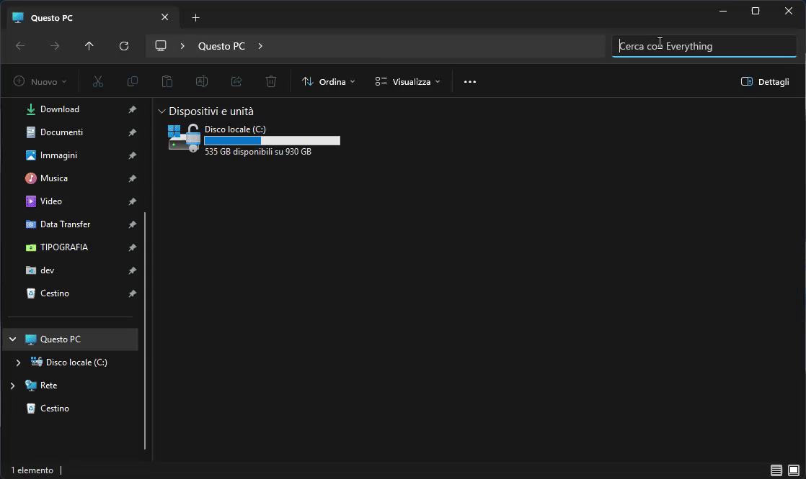
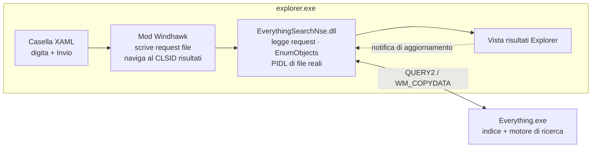

# Everything Search Explorer

[](https://github.com/Alessandro-Vecchio/everything-search-explorer/actions/workflows/ci.yml)


[](LICENSE)

Ricerca istantanea con Everything dentro Explorer: la casella nativa viene sostituita in XAML e i risultati appaiono come una vera cartella.



*Demo da Questo PC: le cartelle virtuali non hanno un percorso filesystem, quindi la ricerca è globale. Da una cartella reale, lo scope predefinito è quella cartella e le sue sottocartelle.*

> **⚠️ PROGETTO IN CORSO - NON È UNA VERSIONE FINITA.**
> Questo repository è uno stato di cantiere pubblicato per tenere traccia delle
> prove e raccogliere feedback. La mod manipola il visual tree XAML di
> `explorer.exe` tramite **XAML Diagnostics**, un'API non supportata: un
> aggiornamento di Windows può romperla in qualsiasi momento. Nessuna garanzia,
> nessun supporto, nessun auto-update. Usalo a tuo rischio, preferibilmente in una
> macchina di prova.
>
> Questo progetto **non è affiliato né supportato da voidtools**. "Everything" è
> un marchio di voidtools; qui viene usato solo come motore di ricerca esterno.
>
> [English](README.md)

- UI nativa di Explorer, non una finestra di ricerca separata.
- Velocità e modificatori di Everything, incluso lo scope per cartella sperimentale.
- File reali nella lista risultati, con menu contestuali e drag & drop nativi.
- Stato di ricerca indipendente per ogni scheda.

## Componenti

| Componente | Dove gira | Ruolo |
|---|---|---|
| `mod/everything-search-explorer.wh.cpp` | mod Windhawk in `explorer.exe` | sostituisce la casella XAML, scrive la request, naviga la vista |
| `nse/EverythingSearchNse.dll` | in-proc in `explorer.exe` | `IShellFolder` che enumera i risultati come file reali |
| Everything | processo separato dell'utente | indice e motore di ricerca (prerequisito) |

L'NSE **non linka né carica `Everything64.dll`**: parla il protocollo IPC
documentato (`QUERY2` via `WM_COPYDATA`) da un thread dedicato con timeout, così
un Everything lento o assente non blocca Explorer.



### Scope

Per impostazione predefinita la ricerca è limitata alla cartella attualmente
mostrata in Explorer, incluse le sue sottocartelle. Non cerca in tutto il disco.
Le cartelle virtuali come "Questo PC" non hanno un percorso filesystem, quindi
lì la ricerca è globale.

Il menu **Opzioni di ricerca** permette di passare da **Tutte le sottocartelle**
(ricorsivo, `path:`) a **Cartella corrente** (solo figli diretti, `parent:`).
Quest'ultima è ancora sperimentale. Le funzioni di ricerca usate da queste
opzioni richiedono Everything 1.5.

La mod mantiene uno stato separato per scheda: testo della casella, caret e
risultati di una scheda non vengono adottati da un'altra.

## Setup

Prepara la macchina con lo script di setup da un prompt di PowerShell 7:

```powershell
.\setup.ps1
```

Controlla Windows 11 x64, PowerShell 7, Visual Studio Build Tools 2022 con il
workload C++, CMake, Windhawk, Everything 1.5+ in esecuzione senza elevazione e
l'impostazione `SeparateProcess`. Se qualcosa manca o è obsoleto chiede una sola
volta e installa ciò che può con winget: Build Tools, Windhawk, Everything e
CMake solo se Visual Studio non lo fornisce già. .NET 8 SDK e WinMD NuGet
servono solo quando va rigenerata la proiezione C++/WinRT: lo script esegue in
automatico quel bootstrap e imposta `SeparateProcess=1` per Explorer. Non compila
né installa il progetto.

Usa `.\setup.ps1 -CheckOnly` per un controllo in sola lettura: restituisce `0` se
tutti i requisiti sono soddisfatti, `1` altrimenti. Lo script attende Invio prima
di chiudersi; `-NoPause` disattiva l'attesa per le esecuzioni automatiche.

Alcuni passi restano manuali:

- accettare il prompt UAC quando parte winget;
- riavviare Explorer dopo la modifica di `SeparateProcess`;
- avviare Everything come utente normale (non come amministratore);
- installare manualmente il Windows SDK se manca (di norma arriva con i Build Tools).

Compila e installa:

```powershell
.\build-nse.ps1                 # NSE -> dist\bin\EverythingSearchNse.dll
.\install-nse.ps1               # registra la NSE (HKCU)
.\mod\build-mod.ps1             # mod -> dist\windhawk
.\install-mod.ps1               # registra la mod (admin) e riavvia Windhawk
```

`.\install-nse.ps1` riavvia Explorer alla fine per caricare la nuova DLL. Se una
ricompila mantiene la stessa versione, lo script usa una cartella sorella
(per esempio `0.3.7-1`) quando la vecchia DLL è ancora bloccata: l'installazione
funziona comunque.

`mod\build-mod.ps1` genera le intestazioni C++/WinRT alla prima esecuzione.
Per rimuovere tutto: `.\uninstall-mod.ps1` e `.\uninstall-nse.ps1`.

Verifica rapida: `.\tools\open-results.ps1 -Query "*.ps1" -Global` apre la
cartella risultati senza passare dalla mod.

Per l'architettura vedi [docs/DIRECT-XAML-REPLACEMENT.md](docs/DIRECT-XAML-REPLACEMENT.md);
[docs/DESIGN.md](docs/DESIGN.md) è in parte storico.

## Come si usa

1. In una finestra di Explorer premi `Ctrl+F` (o `Ctrl+E` / `F3`) per dare il
   focus alla casella sostituita.
2. Digita la query e premi **Invio**: la vista passa alla cartella
   `Everything Search` con nome, tipo, dimensione e data (cartelle incluse).
3. Usa il pulsante **Opzioni di ricerca** nella barra dei comandi per filtrare.
4. **Indietro** torna alla cartella di partenza.

### Opzioni di ricerca

Tutte le voci scrivono modificatori Everything nel file di request e vengono
applicate alla query successiva; non compaiono nella casella di testo.

| Voce | Effetto |
|---|---|
| Tutte le sottocartelle | `path:"cartella\"` (ricorsivo) |
| Cartella corrente | `parent:"cartella"` (solo figli diretti) |
| Data ultima modifica | `date-modified:today` / `7days` / `30days` |
| Tipologia | `doc:` / `image:` / `video:` / `audio:` |
| Dimensioni | `size:0` / `size:0..10kb` / `size:10kb..100kb` |
| File di sistema | `attributes:s` |
| Cartelle compresse (ZIP) | `zip:` |
| Contenuto file | `content:<query>` (può essere molto lento) |

`Cartella corrente` è disponibile solo quando esiste una cartella reale a cui
limitare la ricerca: dalle cartelle virtuali come "Questo PC" resta disabilitata.

## Risoluzione problemi

**La casella di ricerca non viene sostituita.** Verifica `SeparateProcess=1`,
riavvia Explorer e controlla che un'altra mod non stia usando XAML Diagnostics.

**Serve aiuto?** Esegui `.\tools\diagnose.ps1`, oscura i percorsi privati e allega
l'output a un'issue. I problemi noti sono in
[docs/KNOWN-ISSUES.md](docs/KNOWN-ISSUES.md).

**La cartella risultati è vuota.** Verifica che Everything sia in esecuzione
senza elevazione, poi ricompila e reinstalla la NSE:

```powershell
.\build-nse.ps1
.\install-nse.ps1
```

## Limiti noti / problemi aperti

Questa è la parte importante: il progetto **non è pronto**.

- **Cartella corrente non è ancora affidabile**: se la seconda ricerca parte
  dentro la vista risultati, la cartella di origine può andare persa e il
  modificatore diventa `parent:""` (nessun risultato). Vedi il commento nel
  codice in `ApplySearchOptions` / handler `KeyDown`.
- Dopo una seconda ricerca con molti risultati, la nuova lista può comparire
  solo al termine della ri-enumerazione completa.
- La barra "Organizza" legacy può ricomparire in cartelle normali della stessa
  finestra dopo una ricerca.
- Il titolo della finestra/scheda resta `Everything Search` invece di
  `<query> - Risultati ricerca in ...` (Explorer non chiama `GetDisplayNameOf`
  sulla root).
- L'icona desktop `Everything Search` può ricomparire a intermittenza: sembra un
  artefatto della cache delle icone, non una vera cartella namespace.
- Serve `SeparateProcess=1`; con finestre non separate la barra nativa non viene
  toccata. XAML Diagnostics può entrare in conflitto con altre mod o con
  aggiornamenti di Windows.
- Solo x64 / Windows 11. Le cartelle virtuali non hanno percorso filesystem e
  vengono quindi cercate globalmente.
- Vista piatta e read-only: `BindToObject` non è implementato, quindi le cartelle
  nei risultati non navigano dentro la lista.
- Ogni ricerca ri-enumera e perde la selezione; non c'è aggiornamento live mentre
  si digita (serve Invio). Tetto di sicurezza ~393.000 risultati grezzi
  (2048 × 192 batch).
- Il risultato dipende dall'indice di Everything: volumi non indicizzati e
  condivisioni di rete senza folder indexing/ETP non compaiono.
- Nessun auto-update, nessuna firma digitale, nessun supporto.

## Struttura

```
shared/protocol.h        formato request (mod - NSE), flag e filtri
shared/everything_ipc.h  definizioni minime del protocollo QUERY2
nse/                     namespace extension e client IPC
mod/                     mod Windhawk, sostituzione XAML della barra nativa
mod/regenerate-winrt.ps1 genera le intestazioni C++/WinRT, non committate
tests/                   probe NSE, IPC grezzo, test menu e vista dal vivo
tools/open-results.ps1   trigger di test senza mod
tools/diagnose.ps1       correla log della mod e request file per scheda
docs/DEBUGGING.md        metodologia e lezioni sui test dei crash
docs/KNOWN-ISSUES.md     registro strutturato dei problemi aperti
```

## Contribuire / sicurezza

Vedi [CONTRIBUTING.md](CONTRIBUTING.md) e [SECURITY.md](SECURITY.md).

## Licenza

MIT - vedi [LICENSE](LICENSE). Le intestazioni C++/WinRT generate e quelle di
Windhawk restano di rispettivi proprietari; i relativi avvisi sono nei file.
