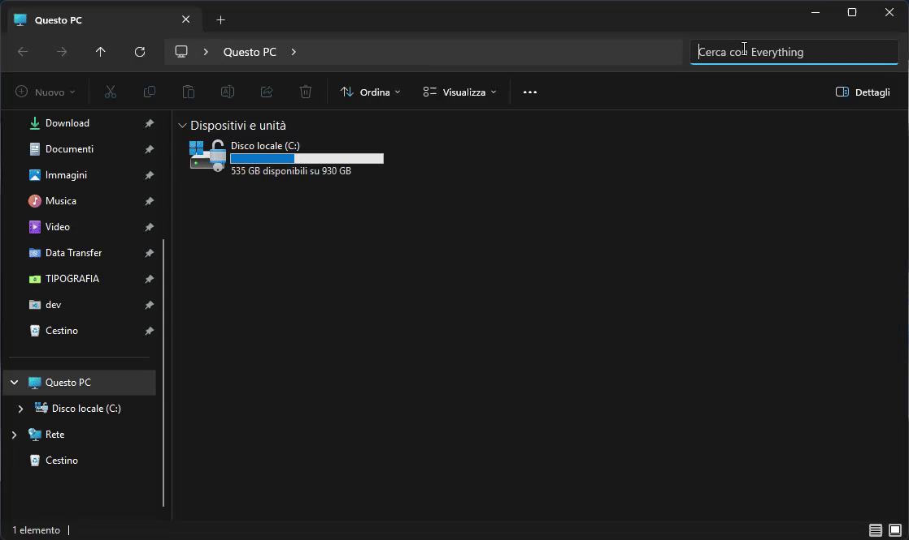
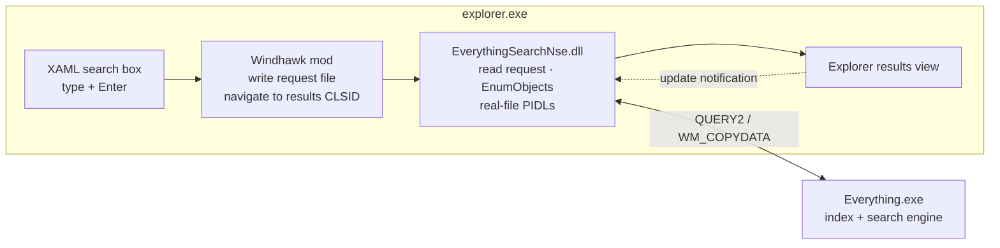

# Everything Search Explorer

[](https://github.com/Alessandro-Vecchio/everything-search-explorer/actions/workflows/ci.yml)


[](LICENSE)

Instant Everything-powered search inside Explorer: the native search box is replaced in XAML and results appear as a real folder.



*Demo from This PC: virtual folders have no filesystem path, so the search is global. From a real folder, the default scope is that folder and its subfolders.*

> **⚠️ WORK IN PROGRESS - NOT A FINISHED PRODUCT.**
> This repository is a construction site published to keep track of experiments
> and collect feedback. The mod manipulates Explorer's XAML visual tree through
> **XAML Diagnostics**, an unsupported API: a Windows update can break it at any
> time. No warranty, no support, no auto-update. Use it at your own risk,
> preferably on a test machine.
>
> This project is **not affiliated with or supported by voidtools**. "Everything"
> is a voidtools trademark; it is used here only as an external search engine.
>
> [Italiano](README.it.md)

- Native Explorer UI, not a separate search window.
- Everything speed and modifiers, including experimental per-folder scope.
- Real files in the result list, with native context menus and drag & drop.
- Independent search state for each tab.

## Components

| Component | Runs in | Role |
|---|---|---|
| `mod/everything-search-explorer.wh.cpp` | Windhawk mod in `explorer.exe` | replaces the XAML box, writes the request, navigates the view |
| `nse/EverythingSearchNse.dll` | in-proc in `explorer.exe` | `IShellFolder` enumerating results as real files |
| Everything | separate user process | index and search engine (prerequisite) |

The NSE **does not link or load `Everything64.dll`**: it speaks the documented
IPC protocol (`QUERY2` over `WM_COPYDATA`) from a dedicated thread with timeouts,
so a slow or missing Everything never blocks Explorer.



### Scope

By default the search is limited to the folder currently shown in Explorer,
including its subfolders. It does not search the whole disk. Virtual folders
such as "This PC" have no filesystem path, so the search is global there.

The **Search options** menu can switch between **All subfolders** (recursive,
`path:`) and **Current folder** (direct children only, `parent:`). The latter is
still experimental. Everything 1.5 is required for the search functions used by
these options.

The mod keeps separate state per tab: box text, caret and results of one tab are
not adopted by another.

## Setup

Prepare the machine with the setup script from a PowerShell 7 prompt:

```powershell
.\setup.ps1
```

It checks Windows 11 x64, PowerShell 7, Visual Studio Build Tools 2022 with the
C++ workload, CMake, Windhawk, Everything 1.5+ running non-elevated and the
`SeparateProcess` setting. When something is missing or outdated it asks once
and installs what it can with winget: Build Tools, Windhawk, Everything and
CMake only if Visual Studio does not already provide one. The .NET 8 SDK and the
NuGet WinMD files are required only when the C++/WinRT projection has to be
regenerated; the script handles that bootstrap automatically and sets
`SeparateProcess=1` for Explorer. It does not build or install the project.

Use `.\setup.ps1 -CheckOnly` for a read-only report: it exits with `0` when all
requirements are met and `1` otherwise. The script waits for Enter before
closing; `-NoPause` disables that for automated runs.

Some steps remain manual:

- accept the UAC prompt when winget starts;
- restart Explorer after the `SeparateProcess` change;
- start Everything as a normal user (not as administrator);
- install the Windows SDK manually if it is missing (it normally arrives with
  the Build Tools).

Build and install:

```powershell
.\build-nse.ps1                 # NSE -> dist\bin\EverythingSearchNse.dll
.\install-nse.ps1               # register the NSE (HKCU)
.\mod\build-mod.ps1             # mod -> dist\windhawk
.\install-mod.ps1               # register the mod (admin) and restart Windhawk
```

`.\install-nse.ps1` restarts Explorer at the end so the new DLL is loaded.
If a rebuild keeps the same version, the script falls back to a sibling folder
(e.g. `0.3.7-1`) when the old DLL is still locked, so the install still works.

`mod\build-mod.ps1` generates the C++/WinRT headers on first run. To remove
everything: `.\uninstall-mod.ps1` and `.\uninstall-nse.ps1`.

Quick check: `.\tools\open-results.ps1 -Query "*.ps1" -Global` opens the results
folder without the mod.

For architecture details see [docs/DIRECT-XAML-REPLACEMENT.md](docs/DIRECT-XAML-REPLACEMENT.md);
[docs/DESIGN.md](docs/DESIGN.md) is partly historical.

## Usage

1. In an Explorer window press `Ctrl+F` (or `Ctrl+E` / `F3`) to focus the
   replaced search box.
2. Type a query and press **Enter**: the view switches to the
   `Everything Search` folder with name, type, size and date (folders included).
3. Use the **Search options** button in the command bar to filter.
4. **Back** returns to the starting folder.

### Search options

Every entry writes Everything modifiers to the request file and applies them to
the next query; they do not appear in the text box.

| Entry | Effect |
|---|---|
| All subfolders | `path:"folder\"` (recursive) |
| Current folder | `parent:"folder"` (direct children only) |
| Date modified | `date-modified:today` / `7days` / `30days` |
| Type | `doc:` / `image:` / `video:` / `audio:` |
| Size | `size:0` / `size:0..10kb` / `size:10kb..100kb` |
| System files | `attributes:s` |
| Compressed folders (ZIP) | `zip:` |
| File contents | `content:<query>` (can be very slow) |

`Current folder` is available only when a real folder exists to scope to: it
stays disabled in virtual folders such as "This PC".

## Troubleshooting

**The search box is not replaced.** Confirm `SeparateProcess=1`, restart Explorer,
and check that another mod is not using XAML Diagnostics.

**Need help?** Run `.\tools\diagnose.ps1`, redact private paths, and attach the
output to an issue. Known problems are listed in
[docs/KNOWN-ISSUES.md](docs/KNOWN-ISSUES.md).

**The results folder is empty.** Check that Everything is running non-elevated,
then rebuild and reinstall the NSE:

```powershell
.\build-nse.ps1
.\install-nse.ps1
```

## Known limitations / open issues

This is the important part: the project **is not ready**.

- **`Current folder` is not yet reliable**: if the second search starts inside
  the results view, the origin folder can be lost and the modifier becomes
  `parent:""` (no results). See the comment in the code in `ApplySearchOptions`
  / the `KeyDown` handler.
- After a second search with many results, the new list may appear only after
  the full re-enumeration finishes.
- The legacy "Organize" bar can reappear in normal folders of the same window
  after a search.
- The window/tab title stays `Everything Search` instead of
  `<query> - Search Results in ...` (Explorer does not call `GetDisplayNameOf`
  on the root).
- The desktop `Everything Search` icon can reappear intermittently: it looks
  like an icon-cache artifact, not a real namespace folder.
- `SeparateProcess=1` is required; without separate windows the native bar is
  not touched. XAML Diagnostics can conflict with other mods or Windows updates.
- x64 / Windows 11 only. Virtual folders have no filesystem path and are
  therefore searched globally.
- Flat, read-only view: `BindToObject` is not implemented, so folders in the
  results do not navigate into the flat list.
- Every search re-enumerates and loses the selection; there is no live update
  while typing (press Enter). Safety ceiling of ~393,000 raw results
  (2048 × 192 batches).
- Results depend on Everything's index: non-indexed volumes and network shares
  without folder indexing/ETP do not appear.
- No auto-update, no code signing, no support.

## Structure

```
shared/protocol.h        request format (mod - NSE), flags and filters
shared/everything_ipc.h  minimal QUERY2 protocol definitions
nse/                     namespace extension + IPC client
mod/                     Windhawk mod: XAML replacement of the native bar
mod/regenerate-winrt.ps1 generates the C++/WinRT headers (not committed)
tests/                   NSE probes, raw IPC, live menu/view tests
tools/open-results.ps1   test trigger without the mod
tools/diagnose.ps1       correlates the mod log with per-tab request files
docs/DEBUGGING.md        crash-test methodology and lessons learned
docs/KNOWN-ISSUES.md     structured ledger of open problems
```

## Contributing / security

See [CONTRIBUTING.md](CONTRIBUTING.md) and [SECURITY.md](SECURITY.md).

## License

MIT - see [LICENSE](LICENSE). Generated C++/WinRT headers and Windhawk headers
remain the property of their respective owners; their notices are in the files.
