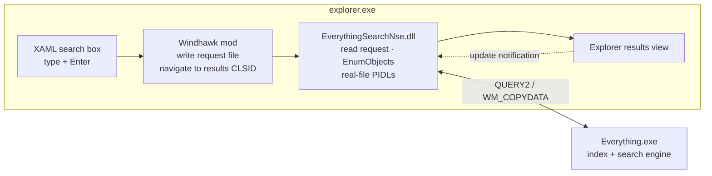

# Design

> This document describes the original design and keeps historical context.
> For the current behaviour prefer [README.md](../README.md) and the source code.
> Architecture, protocol, PIDL, threading and limits below are still valid;
> distribution, refresh and native-search notes were updated to the current mod.

## Goal

Make file search in File Explorer as fast as Everything, without giving up
Explorer's view (multi-selection, native context menus, drag & drop, properties,
"Open with", tabs, history).

Non-goal: reimplementing a file manager or a search engine.

## Why a namespace extension is needed

Explorer exposes no extension point for feeding results into a search. The
results view is a *search folder* populated by Windows Search; the old
federated search connectors (`.searchconnector-ms`) were removed in Windows 8.

A Windhawk mod can hook code, but there is no function to hook that "returns
results" to DefView. The only supported way to show arbitrary items in a
standard Explorer view is to implement a shell folder (`IShellFolder`) and make
Explorer navigate to it.

## Architecture



Three distributed artifacts:

| Artifact | Produced by | Installed by | Notes |
|---|---|---|---|
| mod `.wh.cpp` | repository source | `install-mod.ps1` (admin) | compiled to a DLL with MSVC x64 and registered under HKLM; Windhawk UI reads the source in `ModsSource` |
| `EverythingSearchNse.dll` | `build-nse.ps1` (MSVC) or `tests/run-mingw.ps1` (MinGW) | `install-nse.ps1` (HKCU) | built locally from this repo; no release downloader or setup panel |
| Everything | voidtools | the user | prerequisite, running non-elevated |

### Why direct IPC and not `Everything64.dll`

voidtools' SDK is not a "thin" client that can be safely reused inside the
shell: `src/Everything.c` uses global state protected by a `CRITICAL_SECTION`
and `Everything_QueryW(TRUE)` waits with `WaitForSingleObject(..., INFINITE)`.
Loading it into `explorer.exe` means a busy or elevated Everything blocks the
calling thread and, with it, part of the shell. It would also require
downloading the SDK at every build.

The NSE therefore speaks the documented IPC protocol directly (`QUERY2` in
`WM_COPYDATA` on the `EVERYTHING_TASKBAR_NOTIFICATION` window), with
`shared/everything_ipc.h` as its only dependency (about twenty lines, no
third-party code loaded into the Explorer process).

## Query transport

### Request files

`%LOCALAPPDATA%\EverythingSearchExplorer\request-<HWND>.txt`, UTF-8, one
`key=value` pair per line (split on the **first** `=`). The HWND is the active
tab/window key; a global `request.txt` is written as a fallback for tools and
older windows. The per-window file always wins.

```
seq=123456789
max=0
flags=7
folder=C:\Users\<user>\Documents
query=invoice 2026
filter=date-modified:today
content=0
```

- `seq`: only for change detection; the NSE also compares `query`, `folder`, `max`,
  `flags`, `filter` and `content`.
- `flags`: bit 0 = scoped to the folder, bit 1 = include folders,
  bit 2 = include subfolders (`path:"..."` instead of `parent:"..."`).
- `max=0` means no explicit limit (up to the safety ceiling).
- Atomic write: temporary file + `MoveFileEx(MOVEFILE_REPLACE_EXISTING)`.

The files are deliberately dumb: they survive Explorer restarts and make testing
from PowerShell trivial.

### IPC with Everything

The calling thread never touches `WM_COPYDATA`:

- a single worker thread owns a `HWND_MESSAGE` window;
- `PostMessage(worker, ...)` with a `Job` carrying `replyId`, page (`offset`),
  `max_results` and flags;
- the worker sends with `SendMessageTimeoutW(..., SMTO_ABORTIFHUNG, 4000 ms)`;
- the reply arrives in `WM_COPYDATA` and is accepted **only** if
  `dwData == job->replyId` (base `0x45500000` + 20-bit counter), so a late reply
  from an abandoned query cannot be mistaken for the current one;
- the caller waits on the completion event with a 5000 ms timeout;
- the module stays pinned (`g_cRefDll`) while the worker is alive, because COM
  cannot unload a DLL that still has a window and a thread active.

The layout and semantics of the protocol are documented in
`shared/everything_ipc.h`. Three details verified in the field (Everything
1.5.0.1423) and easy to get wrong:

- `Item2` is `{DWORD flags; DWORD data_offset;}`, `data_offset` is relative to
  the start of `List2`;
- fields are packed in the order of the `request_flags` bits, without padding;
  strings are `DWORD` (character count) + `(len + 1)` WCHARs;
- `PATH` is the **containing folder**, not the full path: it must be joined with
  `NAME` (handling the `C:\` root without adding a separator).

### Paging

Everything truncates the list *before* the NSE can discard folders or drives,
so a folder with many subfolders would return zero files (verified:
`C:\Windows *.exe` returned 0 results). The bridge pages:
`kBatchSize = 2048` raw results per round, up to `kMaxBatches = 192`
(393,216 raw), stopping when the requested total is reached.

## PIDL format

A PIDL is a sequence of `SHITEMID` terminated by a zero-length element. Each
`SHITEMID` starts with `USHORT cb` (total length of the element, field included).

Folder root (8 bytes, deterministic):

```
06 00 | 'E' 00 'S' 00 | 00 00
 cb=6      magic        terminator
```

Child item (relative to the root, as required by the shell contract):

```
[cb] | UTF-16 absolute path + NUL
```

`DefView` combines the root with the relative PIDL to build the absolute PIDL;
for this reason `EnumObjects` **must not** return the root in the child PIDL.

`GetPidlPath` accepts both forms (relative and, defensively, root+item) and
validates the result with `PathIsAbsoluteW` so foreign PIDLs are not interpreted
as paths.

## Delegation to the shell ("proxy folder")

Every item is a real file. The NSE reimplements nothing:

| Method | Implementation |
|---|---|
| `EnumObjects` | lists cached paths, creates relative PIDLs |
| `GetDisplayNameOf` | `FORPARSING`/`FORADDRESSBAR` → real path, otherwise file name |
| `GetAttributesOf` | `SHParseDisplayName` for the requested attributes, with per-item cache to avoid repeated calls during selection and drag |
| `GetUIObjectOf` | `IContextMenu*` → native object from `IShellItemArray::BindToHandler(BHID_SFUIObject)`; `IDataObject` → `BHID_DataObject`; others → `BHID_SFUIObject` |
| `GetDetailsOf` | 4 columns (Name, Size, Type, Date modified) from the cache |
| `CompareIDs` | name (`StrCmpLogicalW`), size, date |
| `BindToObject` | `E_NOTIMPL` (flat read-only view) |
| `SetNameOf` | `E_NOTIMPL` |
| `CreateViewObject` | `SHCreateShellFolderView` with callbacks for count and view mode |

`GetUIObjectOf` is the point that makes everything work: context menus, "Open
with", properties, copy, drag & drop and icons all come from the real filesystem
item.

## Installation

The mod cannot carry a binary (it is compiled from source inside Windhawk), so
the NSE DLL is installed separately with `install-nse.ps1`, which registers the CLSID
under `HKCU\Software\Classes\CLSID\{GUID}` (with
`ThreadingModel=Apartment`) and stores version and path in
`HKCU\Software\EverythingSearchExplorer`. See [README.md](../README.md) for the commands.

The DLL lives in `%LOCALAPPDATA%\EverythingSearchExplorer\nse\<version>\`: a DLL
already mapped by Explorer cannot be overwritten, so each version has its own
folder and an update is a fresh copy plus a registry rewrite.

### Build and install from source

The mod can also be built outside the editor: `mod\build-mod.ps1` uses MSVC x64.
The C++/WinRT headers are not committed: `mod\regenerate-winrt.ps1` recreates
them from the Windows SDK and NuGet (254 files, ~30 MB) when missing. It
automatically discovers `vcvars64.bat` (BuildTools/Enterprise/Professional/
Community) and the `windhawk.lib` of the installed Windhawk engine (highest
version), then passes both paths to `mod\build-mod.cmd` through environment
variables: no version number is hardcoded. It reads `@version` from the source
to name the DLL in `dist\windhawk`.

`install-mod.ps1` closes the loop for development: it builds (or reuses
`-SkipBuild`), copies the DLL to `Engine\Mods\64`, aligns the source in
`ModsSource`, writes
`HKLM\SOFTWARE\Windhawk\Engine\Mods\local@everything-search-explorer` with
`Include`/`Exclude` taken from the `.wh.cpp` metadata, `Architecture=x86-64`,
`Disabled=0` and the two default settings (`maxResults=0`,
`scopeToFolder=1`): without the `Settings` key the engine would read 0 and the
search would return nothing. It then restarts the engine; Explorer is not
terminated, because the mod is injected into the next window.

`uninstall-mod.ps1` first sets `Disabled=1` (a still-mapped DLL must not be
reloaded), then removes the key, binaries and source. The shell component stays
installed: use `uninstall-nse.ps1` for that.

## Native search blocking (historical)

An early version of the mod blocked Explorer's search-as-you-type, which
navigates to the Windows Search folder (`{04731B67-D933-450A-90E6-4ACD2E9408FE}`).
It hooked `SHParseDisplayName`, `ShellExecuteExW/W` and
`IShellBrowser::BrowseObject`, with a `tls_internalNavigation` exemption for its
own calls.

**This code was removed.** The current mod replaces Explorer's native search box
directly in the XAML tree: typing goes into the mod's own `TextBox`, so Explorer
never starts search-as-you-type. No navigation hook is installed. If a window
cannot be identified safely the native bar is left untouched; in that case
Windows Search can still open, by design.

## Refresh flow

1. The mod writes the per-window request file (and the global fallback).
2. `NavigateToResults()` parses `shell:::{GUID}` into a PIDL and calls
   `IShellBrowser::BrowseObject(pidl, SBSP_ABSOLUTE | SBSP_SAMEBROWSER)`.
   If the window was already showing the results folder, browsing to the same
   PIDL is a no-op, so the mod also sends `SHChangeNotify(SHCNE_UPDATEDIR, ...)`.
   There is no direct `IShellView::Refresh()` call in the mod.
3. DefView re-enumerates the virtual folder.
4. `EnumObjects` reads the per-window request file (falling back to the global
   one). If `seq` and the cached fields did not change it reuses the cache,
   otherwise it queries Everything.
5. `MessageSFVCB` handles item count and view mode and leaves the rest to
   DefView's default behaviour.

## Threading and lifetime

- The NSE is in-proc, apartment-threaded (`ThreadingModel=Apartment`).
- `IShellFolder` can be called from multiple threads: the cache is protected by
  `std::mutex`; IPC is serialized by the worker.
- The calling thread never waits more than ~5 s per page; the worker never
  waits more than 4 s for Everything. Lazy pages are loaded outside the folder
  mutex, so other shell threads are not blocked.
- `g_cRefDll` counts objects, `LockServer` **and** the worker's lifetime.
- No C++ exception must cross the COM boundary: the APIs called do not throw;
  allocations use `new (std::nothrow)`.

## Known risks

1. **Shell contract**: the most delicate case is DefView combining root+item.
   If some Windows build passes PIDLs in unexpected forms, `GetPidlPath` must be
   extended (log + test).
2. **Windows 11 tabs**: `IShellWindows` can return multiple browsers for the
   same window; matching uses visibility + focus and is not 100% deterministic.
3. **Nonexistent files**: Everything can return deleted paths. The NSE shows
   them anyway (no per-item `stat`, to avoid slowing down); Explorer reports
   them as missing.
4. **NSE crash = Explorer crash**: no `try/catch` around unknown code, no hooks
   inside the NSE, no calls to `Everything64.dll`.
5. **UIPI**: if Everything runs elevated, a non-elevated process cannot send it
   `WM_COPYDATA`. There is no detection panel any more: Everything must simply
   run non-elevated, as stated in [README.md](../README.md).
6. **Protocol version**: `QUERY2` exists since Everything 1.4.1. Older versions
   are not supported.

## Test status

Verified with `tests/run-mingw.ps1` (MinGW, out-of-process, no Explorer
involved):

- `*.cpp` in the repository → real files with correct size and dates;
- `C:\Windows` + `*.exe` → 50 files (before paging: 0);
- `IContextMenu`/`IContextMenu3` and `IDataObject` on a result → `S_OK`;
- `CF_HDROP` and `Shell ID List Array` → `S_OK`, with the right path in
  `DROPFILES`;
- `GetDetailsEx` → `PKEY_ItemTypeText` = "C++ Source File", `PKEY_Size` = bytes;
- the NSE builds with `-Wall -Wextra` under MinGW; the mod builds with MSVC x64
  and its version is kept in sync with `nse/version.h`.

Verified live in `explorer.exe` (Windows 11 x64, Everything 1.5.0.1423):

- `install-nse.ps1` → DLL loaded from
  `%LOCALAPPDATA%\EverythingSearchExplorer\nse\<version>\EverythingSearchNse.dll`;
- `shell::{GUID}` opens a window whose view contains the repository's real
  files (read with `Shell.Application`), with no crash or WER events;
- `IFolderView2::GetViewModeAndIconSize` → `8` (`FVM_CONTENT`);
- `IFolderView2::InvokeVerbOnSelection(NULL)` (equivalent of double click) →
  the file is opened by the associated program;
- `IShellBrowser::BrowseObject` on an existing window navigates **in place**
  (no second window), even starting from "This PC";
- the observed title is the simple name **"Everything Search"**.

Bugs found and fixed during this test:

1. **`GetDetailsOf` out of range**: it returned `S_FALSE` (success) for column
   headers beyond the 4 available, so DefView kept incrementing `iColumn`
   forever (275,000 calls observed in a few seconds). The contract is
   `E_INVALIDARG`; this applies both to column titles and rows.
2. **`explorer.exe shell:::{GUID}`** does not open the folder and falls back to
   "Documents": you need `SHParseDisplayName` + `ShellExecuteEx` with
   `SEE_MASK_INVOKEIDLIST|SEE_MASK_IDLIST`, or `BrowseObject` from inside.
3. `LocationURL` is empty for a namespace extension: `IsResultsFolder()` now
   compares `IPersist::GetClassID` of the active view with our CLSID, and a
   second search in the same view is refreshed with `SHChangeNotify(UPDATEDIR)`
   rather than `IShellView::Refresh()`.
4. **Context menu**: building it with `SHCreateDefaultContextMenu` +
   `DEFCONTEXTMENU(psf=this)`, or with a wrapper returning a single "Open" item
   for `CMF_DEFAULTONLY`, crashed `SHELL32.dll` on right click. The real shell,
   measured with `tests/context_menu_probe.cpp`, **ignores** `CMF_DEFAULTONLY`
   and always returns the full menu: the correct contract is to delegate to
   `IShellItemArray::BindToHandler(BHID_SFUIObject)`, without a wrapper.
5. **Empty data object**: `SHCreateDataObject(nullptr, ...)` exposed no formats;
   use `SHCreateShellItemArrayFromIDLists` + `BHID_DataObject`.
6. **Initial PIDL**: `SHParseDisplayName("shell:::{GUID}")` can fail with
   `0x80070003` right after an Explorer restart while `CoCreateInstance`
   succeeds; the mod falls back to `IPersistFolder2::GetCurFolder` of the DLL.

## Test checklist

1. `tests/run-mingw.ps1`: does the NSE → IPC → Everything chain work? ✅
2. `tools/open-results.ps1`: does the virtual folder open and show the files? ✅
3. Context menu on a result: "Open", "Open file location", properties. ✅
   (probe; to be confirmed by hand after the crash fix)
4. Drag & drop of a result onto another app. ⏳ (formats verified, to be tested
   with the mouse)
5. Double click on a file (default verb) and on a folder (expected: no effect
   in v1). ✅ files; folders not included in v1.
6. Folder with accents/spaces; query with accents; empty query.
7. Everything closed → error message, no Explorer crash.
8. Two windows, one scoped to `C:\Windows`, one to `D:\`: no interference.
9. `Ctrl+F` with multiple tabs, with a non-active window, with a dialog open.
10. Hot uninstall: `DllCanUnloadNow` and key removal.
